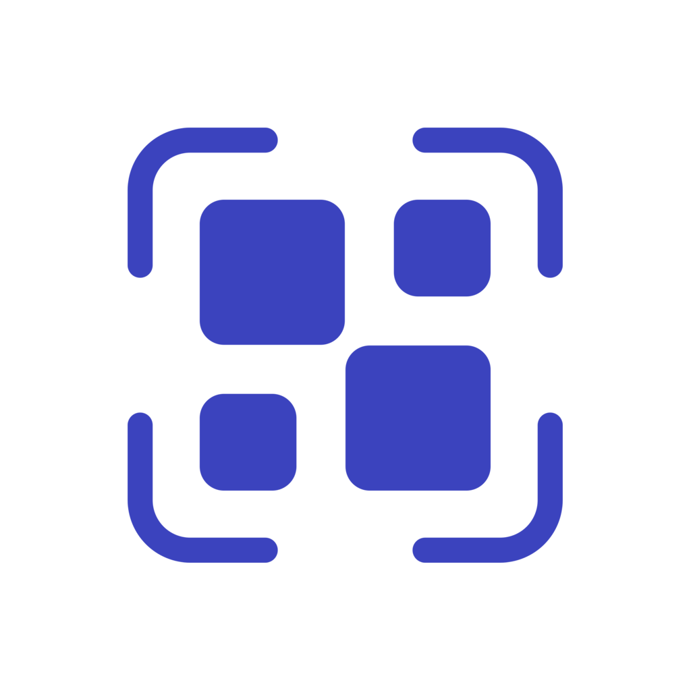
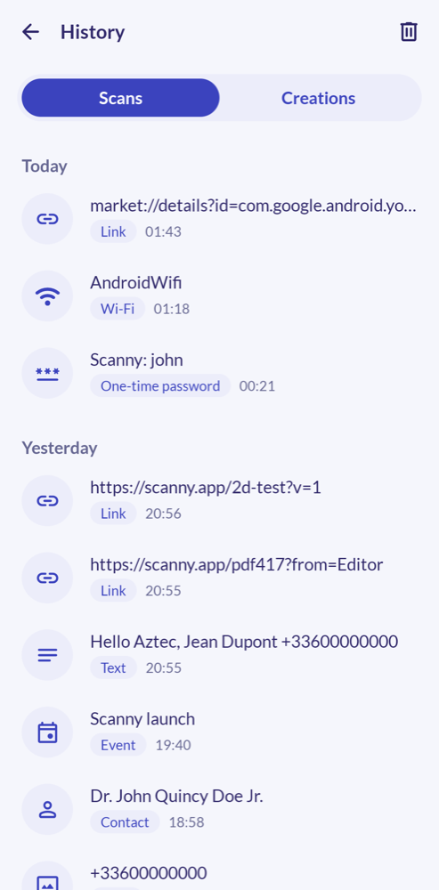
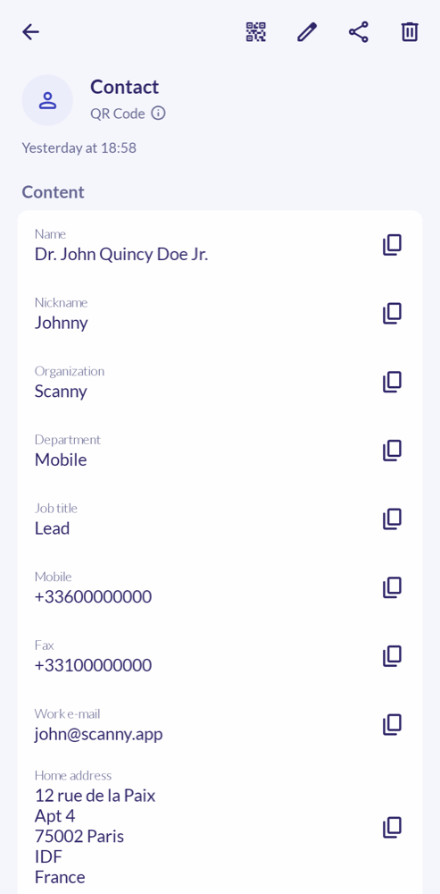
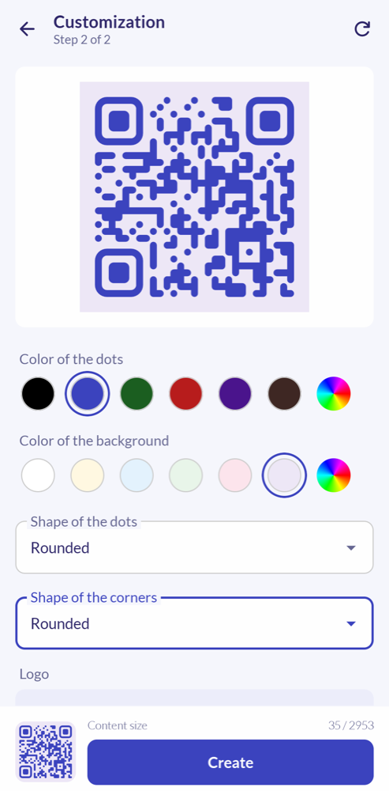

<div align="center">



# Scanny

**Scan and create QR codes and barcodes, on Android and iOS.**<br/>
Light, reliable, without ads, and without ZXing in the app.

[](https://github.com/LudoSkyle/Scanny/actions/workflows/ci.yml)


[](LICENSE)

<a href="https://play.google.com/store/apps/details?id=fr.skyle.scanny"></a>

&nbsp;&nbsp;
&nbsp;&nbsp;


</div>

## Features

- **Scan** with the camera, one code or several at once, or from an image of the gallery: QR Code,
  Data Matrix, Aztec, PDF417, EAN-13, EAN-8, UPC-A, UPC-E, Code 39, Code 93, Code 128, ITF and Codabar.
- **Understand** what a code holds, and act on it: open a link or the deep link of an app, write an
  e-mail, an SMS or an MMS, call, join a Wi-Fi network, add a contact or an event, show a place on
  the map, add a one-time password to an authenticator, open a bitcoin wallet.
- **Create** a QR code, a Data Matrix, an Aztec code, a PDF417 or a barcode, with every field of
  each format, and customize a QR code: colors, gradient, shapes, logo, error correction.
- **History** of the scans and of the creations, kept as long as chosen, with the code drawn again,
  shared or saved as an image.

## Built with

- [Kotlin Multiplatform](https://kotlinlang.org/docs/multiplatform.html) and
  [Compose Multiplatform](https://www.jetbrains.com/compose-multiplatform/): one UI for Android and
  iOS, the native code behind a common interface only (camera, detection, system actions).
- Detection: CameraX and ML Kit on Android, AVFoundation and Vision on iOS.
- Room and DataStore, Koin, kotlinx-datetime, Kermit, and Firebase Crashlytics on Android.
- [qrose](https://github.com/alexzhirkevich/qrose) to draw the codes, with corrected copies of its
  Data Matrix and Aztec encoders ([ADR-0004](docs/adr/0004-encodeurs-data-matrix-et-aztec-corriges.md)).

The modules: `androidApp` and `iosApp` host the app on each platform, `shared` holds the screens and
the navigation, `designSystem` the theme and the generic components, `domain` the models, the parser
and the use cases, `data` the database, the preferences and the repositories.

## Build

Requirements: JDK 17, the Android SDK, and Xcode 26 for iOS.

```bash
./gradlew :domain:allTests :data:allTests :shared:allTests   # tests, on the JVM and the iOS simulator
./gradlew :androidApp:assembleDebug                          # Android app
```

The iOS app opens in Xcode (`iosApp/iosApp.xcodeproj`, scheme `iosApp`); a build phase builds the
`Shared` framework. See [iosApp/CLAUDE.md](iosApp/CLAUDE.md) for the signing.

The signing keys and the Firebase files live in a private submodule. Without it, the project still
builds and tests: the debug build is signed with the default key of Android, and Firebase is left out.

Every pull request is tested and built by GitHub Actions. The documentation of the project, in French,
starts at [docs/INDEX.md](docs/INDEX.md).

## Contributing

If you find an error, please file an issue. Pull requests are welcome; for a substantial change,
please open an issue first to discuss it.

## License

Scanny is licensed under the [Apache License 2.0](LICENSE). The encoders copied from qrose keep its
MIT license, beside them.
